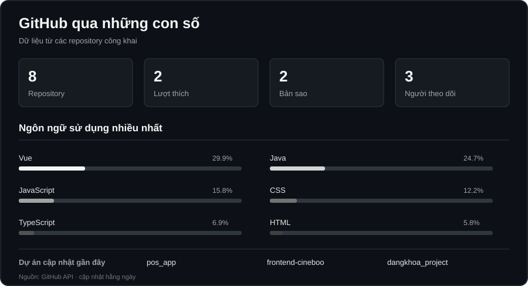

<a href="./README_EN.md">English</a>

  <h1>Cao Đăng Khoa</h1>
  
<strong>Lập trình viên web · Hải Phòng, Việt Nam</strong>

  
Mình xây dựng sản phẩm web và đang trên hành trình phát triển thành lập trình viên full-stack.

  

    <a href="http://dangkh0a.site/">Portfolio</a> ·
    <a href="https://www.linkedin.com/in/khoa-cao-%C4%91%C4%83ng-94051a390/">LinkedIn</a> ·
    <a href="https://www.facebook.com/dangkh0a2004">Facebook</a>
  

---

## Giới thiệu

Mình quan tâm đến giao diện dễ dùng, cấu trúc ứng dụng rõ ràng và cách giao diện kết nối với máy chủ. Mình học qua việc xây dựng dự án, xem lại cách triển khai và cải thiện dần.

## Công nghệ

<table align="center">
  <thead>
    <tr>
      <th align="center">Giao diện</th>
      <th align="center">Máy chủ</th>
      <th align="center">Công cụ và nền tảng</th>
    </tr>
  </thead>
  <tbody>
    <tr>
      <td align="center"></td>
      <td align="center"></td>
      <td align="center"></td>
    </tr>
  </tbody>
</table>

## Ngôn ngữ trong mã nguồn

Danh sách được tổng hợp tự động từ mã nguồn của các repository công khai.

<!-- LANGUAGES:START -->
`Vue` · `Java` · `JavaScript` · `CSS` · `TypeScript` · `HTML` · `Go` · `PHP` · `Batchfile`
<!-- LANGUAGES:END -->

## Dự án

Danh sách được đồng bộ tự động mỗi ngày. Để cập nhật ngay, chạy workflow **Sync public repositories** trong tab **Actions**.

<!-- REPOSITORIES:START -->
| Dự án | Mô tả | Ngôn ngữ chính |
|---|---|---|
| [pos_app](https://github.com/dangkhoa2004/pos_app) | Một ứng dụng quản lý bán hàng toàn diện phát triển bằng Java Swing, thiết kế theo mô hình MVC + UI Layered, hỗ trợ đầy đủ các tính năng quả… | Java |
| [frontend-cineboo](https://github.com/dangkhoa2004/frontend-cineboo) | Vue là một dự án quản trị mạnh mẽ, được xây dựng trên nền tảng Vue.js 3 và Vite. Với kiến trúc dễ tùy biến, giao diện người dùng tinh gọn v… | Vue |
| [dangkhoa_project](https://github.com/dangkhoa2004/dangkhoa_project) | Website portfolio &amp; giới thiệu dịch vụ công nghệ của Cao Đăng Khoa – giao diện hiện đại, responsive, tối ưu UX/UI và thể hiện các dự án thự… | PHP |
| [Road-to-Fullstack](https://github.com/dangkhoa2004/Road-to-Fullstack) | Road to Fullstack: Nơi tôi "vật lộn" với code, "vỡ lẽ" ra nhiều điều, và dần dần biến những ý tưởng điên rồ thành ứng dụng web thực tế. Hãy… | Vue |
| [HTML](https://github.com/dangkhoa2004/HTML) | Kho lưu trữ các dự án HTML, CSS và JavaScript mà tôi đã thu thập được! Kho lưu trữ này bao gồm nhiều dự án thú vị và hữu ích giúp bạn cải t… | JavaScript |
| [badge-preview-service](https://github.com/dangkhoa2004/badge-preview-service) | Ứng dụng web nhỏ gọn cho phép người dùng chọn badge và xem mã nguồn HTML, CSS, JS để tùy biến theo nhu cầu. Xây dựng với HTML, Tailwind CSS… | JavaScript |
| [golang-project](https://github.com/dangkhoa2004/golang-project) | — | Go |
| [dangkh0a-profile](https://github.com/dangkhoa2004/dangkh0a-profile) | — | Vue |
<!-- REPOSITORIES:END -->

## Thống kê GitHub

  

## Kết nối

Bạn có thể xem thêm các dự án hoặc kết nối với mình tại:

[Portfolio](http://dangkh0a.site/) · [LinkedIn](https://www.linkedin.com/in/khoa-cao-%C4%91%C4%83ng-94051a390/) · [Facebook](https://www.facebook.com/dangkh0a2004) · [GitHub](https://github.com/dangkhoa2004)

---

*Cảm ơn bạn đã ghé thăm.*
