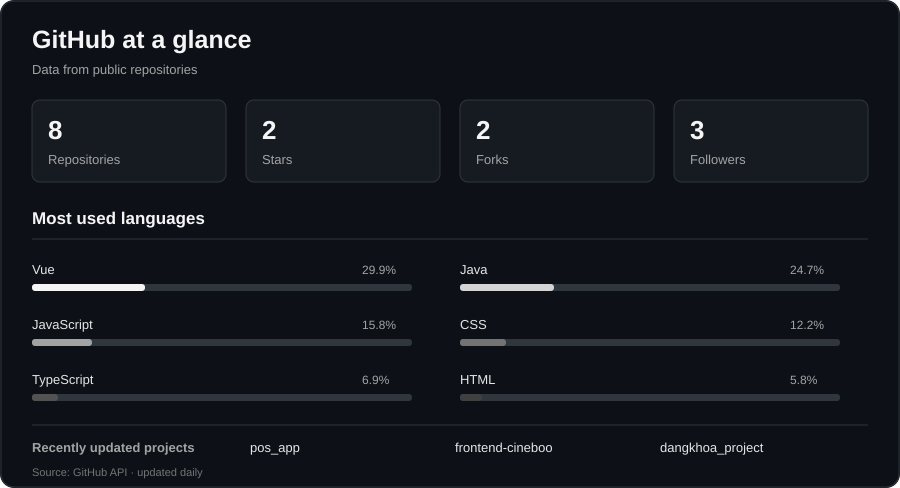

<a href="./README.md">Tiếng Việt</a>

  <h1>Cao Đăng Khoa</h1>
  
<strong>Web Developer · Hai Phong, Vietnam</strong>

  
I build web products and am working toward becoming a full-stack developer.

  

    <a href="http://dangkh0a.site/">Portfolio</a> ·
    <a href="https://www.linkedin.com/in/khoa-cao-%C4%91%C4%83ng-94051a390/">LinkedIn</a> ·
    <a href="https://www.facebook.com/dangkh0a2004">Facebook</a>
  

---

## About

I care about clear interfaces, maintainable application structure, and how the frontend connects to the backend. I learn by building projects, reviewing how they work, and improving them over time.

## Technologies

<table align="center">
  <thead>
    <tr>
      <th align="center">Frontend</th>
      <th align="center">Backend</th>
      <th align="center">Tools &amp; Platforms</th>
    </tr>
  </thead>
  <tbody>
    <tr>
      <td align="center"></td>
      <td align="center"></td>
      <td align="center"></td>
    </tr>
  </tbody>
</table>

## Languages in my repositories

Automatically collected from the source code in my public repositories.

<!-- LANGUAGES:START -->
`Vue` · `Java` · `JavaScript` · `CSS` · `TypeScript` · `HTML` · `Go` · `PHP` · `Batchfile`
<!-- LANGUAGES:END -->

## Projects

This list syncs from GitHub once a day. To refresh it sooner, run **Sync public repositories** from the **Actions** tab.

<!-- REPOSITORIES:START -->
| Repository | Main language |
|---|---|
| [pos_app](https://github.com/dangkhoa2004/pos_app) | Java |
| [frontend-cineboo](https://github.com/dangkhoa2004/frontend-cineboo) | Vue |
| [dangkhoa_project](https://github.com/dangkhoa2004/dangkhoa_project) | PHP |
| [Road-to-Fullstack](https://github.com/dangkhoa2004/Road-to-Fullstack) | Vue |
| [HTML](https://github.com/dangkhoa2004/HTML) | JavaScript |
| [badge-preview-service](https://github.com/dangkhoa2004/badge-preview-service) | JavaScript |
| [golang-project](https://github.com/dangkhoa2004/golang-project) | Go |
| [dangkh0a-profile](https://github.com/dangkhoa2004/dangkh0a-profile) | Vue |
<!-- REPOSITORIES:END -->

## GitHub Analytics

  

## Connect

Explore my projects or get in touch:

[Portfolio](http://dangkh0a.site/) · [LinkedIn](https://www.linkedin.com/in/khoa-cao-%C4%91%C4%83ng-94051a390/) · [Facebook](https://www.facebook.com/dangkh0a2004) · [GitHub](https://github.com/dangkhoa2004)

---

*Thanks for stopping by.*
